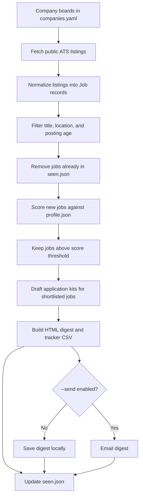

# JobHunt

JobHunt is a personal job-search assistant. It collects openings from public Greenhouse, Lever, and Ashby job boards, filters them against your search preferences, scores relevant roles against your profile, and creates an HTML email digest with application drafts.

JobHunt helps you find and organize opportunities. It does **not** submit applications. You review the results, edit any draft, and apply yourself.

## Project flow



The first filter stage is deterministic and runs before any model call. It checks job title, location, and posting age. The remaining jobs are deduplicated using `seen.json`, scored by the selected language model, and sorted by score. The app drafts materials for up to `max_per_digest` jobs that meet `score_threshold`.

For a local dry run, mock listings pass through the same parsing and filtering pipeline without contacting job boards. The keyword scorer is a development stub and does not understand role fit; use an AI provider for real scoring.

## Features

- Fetches public postings from Greenhouse, Lever, and Ashby boards.
- Parses each provider's listing format into a common job record.
- Filters by included and excluded title patterns, location, remote status, and age.
- Uses a configurable language model provider for screening and drafting.
- Supports different providers for screening and drafting.
- Builds an HTML digest and a CSV application tracker.
- Can send the digest through SMTP when explicitly run with `--send`.
- Offers commands to mark jobs as applied and review tracker totals.
- Includes mock fixtures for offline pipeline checks.

## Requirements

- Python 3.10 or newer
- `pip` and a virtual environment
- An API key for an AI provider when using model-based screening or drafting
- SMTP credentials only if you want to email the digest

## Installation

Open a terminal in the project directory:

```bash
cd JobHunt
```

Create and activate a virtual environment, then install dependencies.

**macOS / Linux**

```bash
python3 -m venv .venv
source .venv/bin/activate
pip install -r requirements.txt
```

**Windows PowerShell**

```powershell
python -m venv .venv
.venv\Scripts\Activate.ps1
pip install -r requirements.txt
```

Check the installation with the offline mock run:

```bash
python -m jobhunt run --mock --scorer keyword
```

This uses bundled sample listings and a sample profile. It requires no API key and does not send email. The keyword scorer is only a pipeline demo; its scores are simple word-overlap estimates, not recommendations.

## Configure your search

### 1. Choose job boards

Edit `companies.yaml`. Each entry has an ATS provider, a board slug, and the company name to show in the digest:

```yaml
companies:
  - {ats: greenhouse, slug: example-company, name: Example Company}
  - {ats: lever, slug: another-company, name: Another Company}
```

Supported `ats` values are `greenhouse`, `lever`, and `ashby`. The slug is the identifier in the company's public careers board URL. The entries currently in the file are examples; check each board and slug before relying on its results. Start with companies you would actually consider.

### 2. Tune filters and limits

Edit `config.yaml` to adjust:

- `filters.include_titles`: regular expressions a title must match.
- `filters.exclude_titles`: regular expressions that disqualify a title.
- `filters.locations`: locations to include.
- `filters.allow_remote`: whether remote listings can pass the location filter.
- `filters.max_age_days`: maximum listing age; set to `null` to disable the age limit.
- `score_threshold`: minimum model score, from 0 to 10, to include a job in the digest.
- `max_per_digest`: maximum number of jobs to shortlist.
- `screen_batch_size`, `screen_jd_chars`, and `draft_jd_chars`: model request sizing.

The configuration file also sets the paths for `profile.json`, `seen.json`, the HTML digest, and the CSV tracker.

## Create your profile

Create a profile from a PDF, text, or Markdown resume:

```bash
python -m jobhunt profile --resume /path/to/resume.pdf
```

By default, the command writes `profile.json` in the project directory. You can choose another output path with `--out`:

```bash
python -m jobhunt profile --resume /path/to/resume.txt --out profile.json
```

PDF input is supported by the Anthropic and Gemini providers. Other providers require a `.txt` or `.md` resume. Review the generated profile and correct anything inaccurate before using it for job scoring or application drafts. `profile.example.json` is a sample format, not your personal profile.

## Configure an AI provider

Copy the environment template and put your credentials in `.env`:

```bash
cp .env.example .env
```

For Windows Command Prompt, use:

```bat
copy .env.example .env
```

The supported providers are:

| Provider | Setting | Credential | PDF resume input |
|---|---|---|---|
| Anthropic | `anthropic` | `ANTHROPIC_API_KEY` | Yes |
| Google Gemini | `gemini` | `GEMINI_API_KEY` | Yes |
| Groq | `groq` | `GROQ_API_KEY` | No |
| OpenAI-compatible API | `openai-compatible` | `GROQ_API_KEY` and `LLM_BASE_URL` | No |
| Ollama | `ollama` | None | No |

Set `LLM_PROVIDER` to choose the provider for both stages. `SCREEN_PROVIDER` and `DRAFT_PROVIDER` can override it separately. Set `SCREEN_MODEL` and `DRAFT_MODEL` to select model IDs when needed. Provider model IDs and availability can change; use a model currently supported by your provider.

Example using Gemini for both stages:

```dotenv
LLM_PROVIDER=gemini
GEMINI_API_KEY=your-key-here
SCREEN_MODEL=your-screening-model
DRAFT_MODEL=your-drafting-model
```

Example using different providers for screening and drafting:

```dotenv
SCREEN_PROVIDER=groq
GROQ_API_KEY=your-groq-key
SCREEN_MODEL=your-groq-model

DRAFT_PROVIDER=anthropic
ANTHROPIC_API_KEY=your-anthropic-key
DRAFT_MODEL=your-anthropic-model
```

For an OpenAI-compatible endpoint, set `LLM_PROVIDER=openai-compatible`, `GROQ_API_KEY` to the endpoint's API key, and `LLM_BASE_URL` to its API base URL. For Ollama, ensure the Ollama service is running and set `LLM_PROVIDER=ollama`; `OLLAMA_HOST` can override the default local address.

Keep `.env`, your real resume, and `profile.json` private. Do not commit API keys, email credentials, or personal profile data. Make sure the repository's `.gitignore` excludes these local files before staging changes.

## Run JobHunt

Run the real pipeline without sending an email:

```bash
python -m jobhunt run
```

Run with a maximum of 10 jobs passed to screening while tuning settings:

```bash
python -m jobhunt run --limit 10
```

Skip application drafting and only screen jobs:

```bash
python -m jobhunt run --no-draft
```

Send the digest by email after configuring SMTP:

```bash
python -m jobhunt run --send
```

Use mock listings for an offline dry run:

```bash
python -m jobhunt run --mock --scorer keyword
```

The run prints counts for fetched jobs, jobs passing filters, new jobs after deduplication, and jobs included in the digest. The HTML digest is written to `out/digest.html`; the tracker is written to `out/tracker.csv`.

## Email settings

To use `--send`, add SMTP settings to `.env`:

```dotenv
SMTP_HOST=smtp.gmail.com
SMTP_PORT=587
SMTP_USER=your-email@example.com
SMTP_PASS=your-app-password
MAIL_TO=destination@example.com
```

For Gmail, use an app password when your account requires one. Email sending is opt-in for local runs: the app only sends when you pass `--send`.

## Track applications

A job's ID is printed or included in the digest. Mark a job as applied with:

```bash
python -m jobhunt applied "greenhouse:example-company:12345"
```

View tracker totals and refresh the CSV export with:

```bash
python -m jobhunt stats
```

`seen.json` stores deduplication and application status. It is local state and should not be committed or shared. Removing it resets the local seen-job history.

## Scheduled runs with GitHub Actions

The workflow at `.github/workflows/daily.yml` is configured for weekdays at 06:00 India time. GitHub Actions scheduling is best-effort, so runs may start later. The workflow requires a `PROFILE_JSON` repository secret and the API credentials for the configured model provider. Add SMTP secrets if you want scheduled digests emailed.

The workflow caches `seen.json` between runs and uploads the generated digest as an artifact. It does not commit the tracker back to the repository. A manual workflow run has a `dry_run` input: enable it to build an artifact without sending email. Review the workflow and configure its GitHub repository secrets and variables before enabling scheduled use.

Common repository secrets include:

- `PROFILE_JSON`
- `GEMINI_API_KEY`, `ANTHROPIC_API_KEY`, or `GROQ_API_KEY`, depending on the provider
- `SMTP_HOST`, `SMTP_PORT`, `SMTP_USER`, `SMTP_PASS`, and `MAIL_TO` if emailing

Optional repository variables include `LLM_PROVIDER`, `SCREEN_PROVIDER`, `DRAFT_PROVIDER`, `SCREEN_MODEL`, and `DRAFT_MODEL`.

## Project layout

```text
jobhunt/
  __main__.py   module entry point
  cli.py        profile, run, applied, and stats commands
  fetch.py      ATS requests, job model, and provider parsers
  prefilter.py  title, location, and posting-age filters
  providers.py  language model provider adapters
  llm.py        profile extraction, screening, and drafting
  digest.py     HTML digest generation
  mailer.py     SMTP email delivery
  store.py      deduplication, application status, and CSV export
  mock.py       offline ATS-shaped fixtures

tests/
  test_parsers.py
  test_llm.py

companies.yaml  public job boards to fetch
config.yaml     filters, model sizing, thresholds, and output paths
profile.example.json
                sample profile structure
.env.example    environment variable template
SETUP.md        detailed beginner setup guide
```

## Tests

Run the test suite from the project root:

```bash
python -m pytest tests -q
```

The tests use local fixtures and stubs; they do not require live ATS requests or API keys.

## Safety and limitations

- JobHunt only reads public ATS listings from its configured boards.
- It does not apply for jobs or submit forms.
- Model scores and generated drafts can be wrong. Review job details and every draft before acting on them.
- Board slugs can change or become inactive. Check the per-board results when a company returns no listings.
- The keyword scorer is for offline demonstration only and should not be used to judge real job fit.
